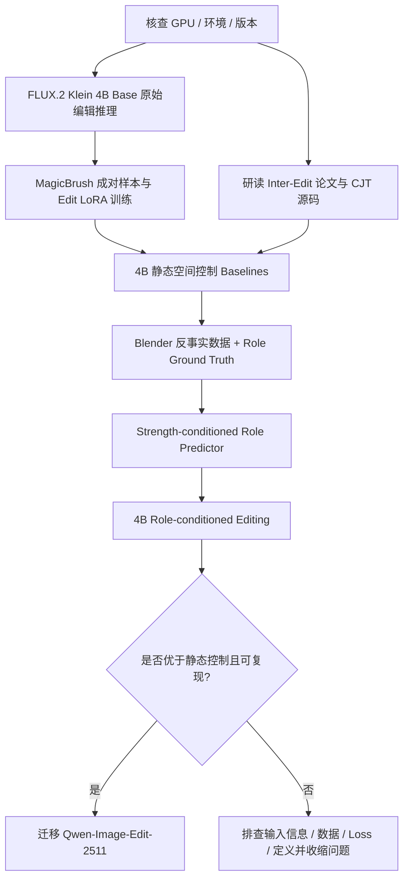

# Image Editing 项目：前期准备、Baseline 复现与 Inter-Edit 研读路线

> **最终确定的技术路线：先在 FLUX.2 Klein 4B Base 上验证方法，若有效，再迁移到 Qwen-Image-Edit-2511。** 现阶段应该先建立可训练、可评估的 4B 基线，研读 Inter-Edit 的空间控制机制；不需要先完整重训 Inter-Edit 的 Qwen 基线。
>
> 本文为 **可执行的工程与研究路线文档**。已通过论文、官方模型卡和开源 README 核对主要入口，但**没有在你们的服务器上完成模型下载、推理或真实 LoRA 训练**。文中的参数为首轮建议配置，必须经过显存与收敛性测试。

## 0. 一页摘要：先做什么、后做什么

| 阶段 | 目标 | 现在执行？ | 核心交付物 |
|---|---|---|---|
| A0：环境与资产 | 统一代码、显卡、模型、数据格式 | ✅ 立即 | 环境记录、目录结构、下载清单 |
| A1：4B 原始推理 | 跑通 **FLUX.2 Klein 4B Base** 图像编辑 | ✅ 立即 | 固定验证集的输入/输出画廊 |
| A2：4B Edit LoRA | 跑通官方的成对图像编辑微调 | ✅ 立即 | 一个可重载的 LoRA checkpoint |
| A3：Inter-Edit 研读 | 理解原图 + 粗 Mask 联合控制的设计 | ✅ 与 A1/A2 并行 | 代码走读笔记、迁移接口清单 |
| A4：静态空间控制 | 在 **相同的 4B 基模**上建立 Mask 基线 | 🔜 A2 后 | Static / Dilated / Soft Mask 结果 |
| B1：反事实数据 | 生成多强度物体移动和阴影标签 | 🔜 A4 同期 | `(x, c, M, t, y_t, R_t)` 数据 |
| B2：我们的创新 | 训练强度条件化 `Role Predictor` 并接入生成器 | 🔜 B1 后 | Dynamic Role Field + Adapter |
| B3：严格验证 | 同强度、相近变化面积的公平比较 | 🔜 B2 后 | 消融、失败案例、统计置信区间 |
| C：Qwen 迁移 | 前一阶段成立后再试 Qwen-2511 | ⏳ 条件触发 | Qwen + Static / Role 的配对对照 |



---

## 1. 为什么现在不用完整复现 Inter-Edit？

### 1.1 Inter-Edit 在做什么

**Inter-Edit: First Benchmark for Interactive Instruction-Based Image Editing**（CVPR 2026）研究的是：用户只提供简短编辑指令和**不精确的空间指示**，模型如何正确定位并执行编辑，同时保持视觉自然度。

官方公开的 **Control-Image Joint Training（CJT）**：

- 基模为 **Qwen-Image-Edit-2511**；
- 控制输入是 **原图 + 二值编辑 Mask**；
- 原图与 Mask 一起进入编辑生成系统，而非只在最终 RGB 输出上后处理；
- 官方仓库提供训练、推理、benchmark 和评估代码。

这对我们的启发是 **如何将空间信息作为模型条件，并保持训练/推理一致**，但它不直接预测随强度变化的三类空间角色。

论文：[CVPR 2026 — Inter-Edit](https://openaccess.thecvf.com/content/CVPR2026/html/Liu_Inter-Edit_First_Benchmark_for_Interactive_Instruction-Based_Image_Editing_CVPR_2026_paper.html)  
代码：[Delong-liu-bupt/Inter-Edit](https://github.com/Delong-liu-bupt/Inter-Edit)

### 1.2 “复现”有三个等级，不要混为一谈

| 层级 | 工作 | 我们在什么时候做？ |
|---|---|---|
| **阅读与接口分析** | 读 CJT 数据流、控制条件、Loss、评估代码 | **现在必须做** |
| **4B 上的概念移植** | 参照 Inter-Edit 的空间控制思想，在 FLUX.2 4B 构建静态 Mask 条件编辑 | **4B LoRA 之后**；这是新实现，不等于原论文严格复现 |
| **Qwen 上的官方复现** | 按 Inter-Edit 官方配方训练/运行 Qwen-2511 CJT | **仅当 4B 阶段验证有效** |

> **重要区别：Inter-Edit 的代码绑定 Qwen 管线，不能把它的 `train_qwen_edit_lora.py` 直接换一个模型 ID 就当作 FLUX.2 的训练程序。** FLUX.2 的控制输入接口、Transformer 和采样管线需单独适配。

### 1.3 Inter-Edit 应该阅读哪些文件

Git clone：

```bash
git clone https://github.com/Delong-liu-bupt/Inter-Edit.git external/Inter-Edit
```

重点看：

1. `README.md` — 模型、数据格式、训练配置和推理接口。
2. `dataset_utils.py` — 原图、编辑目标、Mask、bbox 与指令的读取。
3. `pipeline_qwenimage_edit_plus.py` — 两路控制图像怎样进入 Qwen 推理管线。
4. `train_qwen_edit_lora.py` — 训练时如何组织输入、生成噪声/时间步并计算 loss。
5. `train_configs/train_config_2511.yaml` — LoRA、精度、分辨率和缓存配置。
6. `evaluation/objective_metrics.py` — 论文 benchmark 使用哪些指标，哪些指标可复用。

**输出一份 `notes/inter_edit_code_review.md`：**

- 控制条件：Mask 是怎样预处理与编码的？
- 条件融合：原图、Mask、文本分别在哪一步与模型交互？
- 训练目标：从数据 batch 到 flow-matching loss 的完整张量流。
- 泛化到 4B：哪些思想可用、哪些代码不可复用？
- 基线公平性：Static Mask 应如何输入到 4B，避免与 Ours 使用不同信息量？

---

## 2. 现在真正需要下载什么？

### 2.1 资源清单

| 资源 | 用途 | 现在下载？ | 链接 |
|---|---|---|---|
| **FLUX.2 Klein 4B Base** | 第一阶段编辑基模和微调目标 | ✅ | [Hugging Face](https://huggingface.co/black-forest-labs/FLUX.2-klein-base-4B) |
| **ai-toolkit** | FLUX.2 的 Edit LoRA 训练框架 | ✅ | [GitHub](https://github.com/ostris/ai-toolkit) |
| **MagicBrush** | 第一轮 `(source, instruction, target, mask)` 成对数据 | ✅，先小样本 | [Hugging Face](https://huggingface.co/datasets/osunlp/MagicBrush) |
| **Inter-Edit 源码** | 阅读 CJT 的控制路径 | ✅，只需 Git 代码 | [GitHub](https://github.com/Delong-liu-bupt/Inter-Edit) |
| Inter-Edit-Train | 用于后续对比与空间控制数据 | ⏳ 暂不下载完整集 | [Dataset](https://huggingface.co/datasets/a1557811266/Inter-Edit-Train) |
| Inter-Edit-Test | 后续外部空间编辑评估 | ⏳ 评估时下载 | [Dataset](https://huggingface.co/datasets/a1557811266/Inter-Edit-Test) |
| Qwen-Image-Edit-2511 | 第二阶段 Qwen 迁移 | ⏳ 暂时不用 | [Hugging Face](https://huggingface.co/Qwen/Qwen-Image-Edit-2511) |
| Blender / Kubric | 反事实数据、阴影消融 | ⏳ 进入数据阶段后 | [Blender](https://www.blender.org/) · [Kubric](https://github.com/google-research/kubric) |

**模型选择务必准确：**`FLUX.2-klein-base-4B` 是适合训练的**未蒸馏 Base 版本**；`FLUX.2-klein-4B` 是面向低步数推理的蒸馏版本。初期训练和严格 baseline 必须固定在 Base 版本；不要混用后再比较数值。

### 2.2 数据规模：不要一开始全量下载

MagicBrush 官方数据卡给出的划分：

- `train`：8,807 个编辑步骤；
- `dev`：528 个编辑步骤；
- `test`：1,053 个编辑步骤（依官方 benchmark 规则处理）。

常见字段包括 `img_id`、`turn_index`、`source_img`、`mask_img`、`instruction`、`target_img`。数据集总体体积约几十 GB；前期只取约 **200–500 个 train steps 和 30–100 个 dev steps** 用于 smoke test 和小规模研究，不要把 train/dev/test 混合。MagicBrush 的 Mask 是自由形式编辑区域，不是 `D_t` 物理连带效果的标签。

**注意多轮编辑**：同一 `img_id` 的不同 `turn_index` 具有依赖关系；若自行重划 train/val/test，应按编辑会话或 `img_id` 分组，避免同一编辑链泄漏到不同集合。

### 2.3 建议目录

```text
image-editing/
├── README.md
├── configs/
│   ├── flux2_edit_lora_debug.yaml
│   └── experiments/
├── scripts/
│   ├── check_env.py
│   ├── infer_base.py
│   ├── prepare_magicbrush.py
│   └── evaluate_baselines.py
├── data/
│   ├── magicbrush/
│   │   ├── train/
│   │   │   ├── reference/       # source images
│   │   │   ├── target/          # edited target + same-stem .txt
│   │   │   ├── mask/            # 保留原始 Mask
│   │   │   └── manifest.csv
│   │   └── dev/
│   └── synthetic/              # 后续 Blender 数据
├── models/                     # 模型权重，不提交 Git
├── outputs/
│   ├── base_inference/
│   ├── lora_debug/
│   └── evaluations/
├── notes/
│   ├── inter_edit_code_review.md
│   └── experiment_log.md
└── external/
    ├── ai-toolkit/
    └── Inter-Edit/
```

建议 `.gitignore` 排除 `models/`、`outputs/`、数据集图像和缓存文件，只提交代码、配置、README、实验记录与少量版权允许的可视化示例。

---

## 3. 第一步：服务器和环境核查

### 3.1 确认真实 GPU

此前提到的 `A6000 40GB` 需要先核实：常见 NVIDIA RTX A6000 标配 **48GB**，而 **A100 40GB** 是不同型号。不要依口头名称定方案。

```bash
nvidia-smi --query-gpu=index,name,memory.total,memory.free,driver_version --format=csv
nvidia-smi topo -m
python --version
nvcc --version || true
```

记录 GPU 型号、数量、可用显存、驱动、CUDA、PyTorch 版本、GPU 互联拓扑。

### 3.2 建立 Python 环境

```bash
conda create -n image-edit python=3.11 -y
conda activate image-edit

# 首先按 https://pytorch.org/get-started/locally/ 安装与驱动匹配的 PyTorch
# 然后安装常用推理依赖
pip install -U diffusers transformers accelerate safetensors huggingface_hub \
  datasets pillow pandas peft

python - <<'PY'
import torch, diffusers
print('torch:', torch.__version__)
print('diffusers:', diffusers.__version__)
print('cuda:', torch.cuda.is_available())
print('GPU:', torch.cuda.get_device_name(0) if torch.cuda.is_available() else 'none')
PY
```

**注意：**`ai-toolkit` 可能有自己要求的 PyTorch、CUDA 扩展和 Python 版本；跑官方训练之前应优先遵循其最新 README。若与推理环境冲突，可另建 `image-edit-train` Conda 环境。初次运行成功后，使用 `pip freeze` 和 Git commit hash 固定版本。

### 3.3 模型下载

第一种做法：让 Hugging Face/Diffusers 在 `from_pretrained` 时自动下载并缓存。

第二种做法：提前保存到服务器本地目录：

```bash
python - <<'PY'
from huggingface_hub import snapshot_download
snapshot_download(
    repo_id='black-forest-labs/FLUX.2-klein-base-4B',
    local_dir='models/FLUX.2-klein-base-4B',
)
PY
```

需要网络或合法的镜像访问。出现权限限制时，先确认模型页的使用条件和账户登录状态，不要把 Hugging Face token 写进脚本或仓库。

---

## 4. 第二步：先跑通原始 4B 图像编辑推理

**目标不是生成好看的图片，而是验证：原图 → 指令 → 编辑结果 的数据流可用。**

参考官方模型卡的 Diffusers 示例，最小伪代码：

```python
import torch
from diffusers import DiffusionPipeline
from PIL import Image

model_id = 'black-forest-labs/FLUX.2-klein-base-4B'
pipe = DiffusionPipeline.from_pretrained(model_id, torch_dtype=torch.bfloat16)
pipe = pipe.to('cuda')  # 如显存不足，按当前 Diffusers 文档改用 offload

source = Image.open('examples/source.png').convert('RGB')
result = pipe(
    image=source,
    prompt='Move the red mug slightly to the right and keep the desk unchanged.',
).images[0]
result.save('outputs/base_inference/example.png')
```

以上为**参考官方接口的最小示意**，不同版本的 pipeline 可能需要显式 `height/width/num_inference_steps/guidance_scale`；请优先对齐下载模型卡上的当前用法。Base 模型不是蒸馏 4-step 模型，不应照搬其低步数设置。

### 4.1 固定初步验证集

第一轮建议选 **12–20 个样本**，覆盖：

- 添加或改变小物体；
- 局部物体替换；
- 背景保留要求较强的编辑；
- 移动、缩放或颜色修改（尽量找具有单一清晰动作的案例）。

每个测试记录：`sample_id / source / instruction / target / output / seed / steps / cfg / resolution / model_revision`。

### 4.2 必须检查的输出

- [ ] 图片能够成功生成且没有 OOM。
- [ ] 原始输入图片保持正确的宽高比、色彩模式和方向。
- [ ] 固定 seed 与配置能重复运行。
- [ ] 能直观比较 **source / target / prediction**。
- [ ] 记录每张卡峰值显存与每张图耗时。
- [ ] 不将图片好坏的主观感受当作正式定量指标。

---

## 5. 第三步：准备 MagicBrush Edit LoRA 数据

### 5.1 为什么优先 MagicBrush

它已经提供现成的 `(source, instruction, target)` 三元组和编辑 Mask，正好用于验证编辑训练框架。与其先搭建复杂的 Blender 流程，更应该先证明 **LoRA 训练和推理能回到同一个控制任务**。

**但要区分：** MagicBrush 仅适合第一轮编辑训练，不能直接当作连续强度 `t` 或必要物理后果 `D_t` 的真值数据。

### 5.2 ai-toolkit 官方 Edit LoRA 数据结构

Black Forest Labs 的官方 LoRA 指南采用成对目录：

```text
data/magicbrush/train/
├── reference/
│   ├── 000001.png        # 源图
│   └── 000002.png
└── target/
    ├── 000001.png        # 对应目标图
    ├── 000001.txt        # 编辑指令
    ├── 000002.png
    └── 000002.txt
```

Mask 作为额外文件单独保留，不能假设只要把 Mask 放进目录，ai-toolkit 就会自动进行受 Mask 约束的编辑训练；后续需要专门开发 mask-conditioning 或采用它支持的多控制图像接口。

官方入口：[Fine-tune FLUX.2 [klein] with LoRA — Train an edit LoRA](https://huggingface.co/blog/black-forest-labs/flux-2-klein-lora)  
训练器模型文档：[Ostris ai-toolkit FLUX.2 Klein 4B](https://ostris.com/docs/ai-toolkit/models/flux2-klein-4b)

### 5.3 小规模数据准备示意

下面示例读取 `MagicBrush` 的 train 子集并导出成对图片及文本。为节省首次下载量，可尝试 `streaming=True`；实际传输量取决于远端数据分片与缓存。正式实验应记录采样规则和样本 ID。

```python
from pathlib import Path
from datasets import load_dataset

root = Path('data/magicbrush/train')
for sub in ['reference', 'target', 'mask']:
    (root / sub).mkdir(parents=True, exist_ok=True)

ds = load_dataset('osunlp/MagicBrush', split='train', streaming=True)
for i, item in enumerate(ds):
    if i >= 200:
        break
    stem = f'{i:06d}'
    item['source_img'].convert('RGB').save(root / 'reference' / f'{stem}.png')
    item['target_img'].convert('RGB').save(root / 'target' / f'{stem}.png')
    (root / 'target' / f'{stem}.txt').write_text(item['instruction'], encoding='utf-8')
    if item.get('mask_img') is not None:
        item['mask_img'].save(root / 'mask' / f'{stem}.png')
```

**注意：**这只演示训练数据目录转换；正式应同时生成 `manifest.csv` 保存原始 `img_id`、`turn_index`、分割、尺寸和样本 ID，并做好格式和质量筛查。验证数据必须另从 `dev` 读取，绝不可把 benchmark 测试集作为训练数据。

### 5.4 数据清洗

- [ ] source、target、mask 使用稳定的共同 ID。
- [ ] 图像统一 RGB；Mask 通道/取值单独确认。
- [ ] 确认 source 与 target 配对不是错位图。
- [ ] 检查指令为空、图片打不开、尺寸错误等坏数据。
- [ ] 若发生 resize，**所有控制图的几何变换一致**；Mask 用最近邻插值。
- [ ] 抽查至少 30 组编辑对并生成 contact sheet。
- [ ] 保持训练/开发/最终测试分离。

---

## 6. 第四步：先复现 FLUX.2 Klein 4B Edit LoRA

### 6.1 应该复现哪份代码？

优先使用：[ostris/ai-toolkit](https://github.com/ostris/ai-toolkit) 和 [BFL Edit LoRA 教程](https://huggingface.co/blog/black-forest-labs/flux-2-klein-lora)。

```bash
git clone https://github.com/ostris/ai-toolkit.git external/ai-toolkit
```

按其当前 README 创建环境和安装依赖，使用 `FLUX.2-klein-base-4B` 的 **Edit LoRA** 配置，而非普通 style/T2I LoRA。

### 6.2 Edit LoRA 配置关键字段

下面是**结构片段，不是可以直接独立运行的完整 YAML**，应在当前 ai-toolkit 官方样例上修改：

```yaml
datasets:
  - folder_path: /absolute/path/data/magicbrush/train/target
    control_path: /absolute/path/data/magicbrush/train/reference
    caption_ext: txt
    resolution: [512]

model:
  arch: flux2_klein_4b
  name_or_path: black-forest-labs/FLUX.2-klein-base-4B

train:
  batch_size: 1
  steps: 150
  gradient_checkpointing: true
  noise_scheduler: flowmatch
  dtype: bf16
```

`control_path` 是关键：它向训练器提供配对的输入图像，从而将普通风格 LoRA 变为编辑 LoRA。可以参照官方文档使用 `quantize`、`low_vram`、latent cache 等选项，但不要一开始叠加大量尚未验证的优化。

### 6.3 第一次训练只做 Smoke Test

**第一轮建议设置**：

| 参数 | 起步值 | 为什么 |
|---|---|---|
| Backbone | FLUX.2 Klein 4B Base | 固定第一阶段模型 |
| GPU | 1 张可用卡 | 减少多卡排错难度 |
| Resolution | 512 | 降低开销 |
| LoRA rank | 16 或 32 | 起步尝试，不是最优值 |
| Per-device batch | 1 | 易排错 |
| Training steps | 100–200 | 验证 loss/checkpoint 路径 |
| Dtype | BF16 | 若硬件支持 |
| Gradient checkpointing | 开启 | 降低激活开销 |
| Train split | MagicBrush 小规模子集 | 易快速迭代 |
| Dev split | 独立 MagicBrush dev | 检查过拟合和表现 |

先确认训练能够完成并导出 checkpoint，然后在**相同 seed / 指令 / 源图 / 采样设置**下比较：

1. `FLUX.2 4B Base (zero-shot)`；
2. `FLUX.2 4B Base + Edit LoRA`。

**不要以 100–200 步一定能提升质量为预设**：这一步只验证可训练和可重载。质量比较需要后续更多训练与单独 dev 调参。

### 6.4 第一轮验收标准

- [ ] 训练连续跑通 100–200 steps，没有 NaN、OOM 和数据错位。
- [ ] 保存的 LoRA 可被正确加载。
- [ ] loss 曲线、显存日志、训练配置和版本号已记录。
- [ ] 同组 dev 图像能产生可复核的 before/after 对比。
- [ ] 清楚区分“工程复现成功”与“研究性能提升”。

---

## 7. 第五步：在 4B 上建立 Inter-Edit 风格的静态空间 Baseline

这一步**不是把 Inter-Edit 的 Qwen 权重换成 FLUX 权重**，而是在 4B 的训练管线中设计空间条件。推荐先建立这些对照：

| 名称 | 输入空间信息 | 用途 |
|---|---|---|
| B0：4B Edit LoRA | 无额外 Mask | 测试普通编辑能力 |
| B1：Static Mask | 用户粗 Mask | 静态空间引导 |
| B2：Dilated Mask | 扩张后的静态 Mask | 排除“编辑区域变大”的简单解释 |
| B3：Soft Mask | 模糊/软边界静态 Mask | 排除边界平滑的贡献 |
| B4：Oracle Role Field | 真值 `T/D/P` | 测量上界；**不能作为最终推理方法** |
| B5：Predicted Dynamic Role | 模型预测 `T/D/P` | 我们要证明的实际可部署方法 |

**最小必要比较：B1、B2、B3、B5**。B4 是诊断“角色信息有用但预测器不准”还是“角色信息本身没用”。

### 7.1 最先需要解决的工程问题

如何将 Mask / Role Field 输入 FLUX.2？

可先尝试官方训练器支持的多控制图像输入机制，但需要确认数据和管线是否可以可靠接收源图+控制图；也可以开发轻量 Role Encoder，把控制图映射为生成器可消费的条件特征。

**不能用仅在输出上做 RGB Mask 混合来替代完整的空间编辑控制**。直接像素混合可作为简单参考，但易在遮挡、阴影和新背景处留下接缝。

### 7.2 公平性要求

不同方法必须：

- 使用同一 FLUX.2 4B Base checkpoint；
- 尽量共享数据、训练步数、LoRA rank、分辨率、推理步骤和 seed；
- 有同等原始空间提示（例如都输入相同粗 Mask）；
- 分开报告只用 GT Role 的 Oracle 上界；
- 不拿 4B+额外 Oracle 信息直接宣称胜过无 Mask 的 Qwen；
- 避免训练与测试场景重叠。

---

## 8. 后续数据与我们的方法（暂不作为第一周任务）

### 8.1 数学定义

输入：源图 `x`、指令 `c`、粗空间提示 `M`、目标强度 `t∈[0,1]`。

我们的预测器：

$$
R_t=H_\phi(x,c,M,t), \qquad R_t(p)=(r_T(p),r_D(p),r_P(p))
$$

角色定义：

- **`T_t` — Direct Target**：物体旧位置、新位置和需要补全的曝光区域；
- **`D_t` — Required Consequence**：根据编辑的物理影响必须同步修改的阴影、反射等；
- **`P_t` — Protected**：与编辑无关的区域。

受控编辑器：

$$
y_t=F_{\theta,\Delta\theta}(x,c,t,R_t)
$$

其中基础权重 `θ` 冻结、LoRA 或条件适配器 `Δθ` 训练。**不同编辑强度下，`R_t` 应有可解释的变化**，否则方法可能退化成静态 Mask。

### 8.2 如何生成监督数据

先用 Blender 创建固定相机、光源和物体的桌面场景：

1. 原场景渲染 `x_0`；
2. 只改变一个物体位置，并采样多个强度 `t`；
3. 保持渲染设定一致，得到 `x_t`；
4. 用对象 ID/旧新 footprint 获取 `T_t`；
5. 进行阴影或反射的开关/消融，辅助识别必要连带变化 `D_t`；
6. 其余区域作为 `P_t` 的候选，人工抽查歧义标签；
7. 保存 `(source, instruction, coarse_mask, strength, target, role_map)`。

**重要限定：**可见像素差异 `|x_t-x_0|` 不是“必要改变”的真值。变化可能来自渲染噪声或非必要现象；应区分真正的后果区域和任意像素变化。

### 8.3 指标

- **Edit Success**：是否完成指令；
- **Required-effect accuracy**：阴影、背景补全等必要后果质量；
- **Protected-region drift**：保护区 LPIPS/L1 等偏移；
- **Strength fidelity**：用户期望强度与感知编辑程度偏差；
- **Actual changed area**：实际可见变化像素比例；
- **自然度 / 主观盲评**：判断编辑是否协调。

应优先做 **相近编辑完成度（以及相近实际变化面积）下的 success-preservation 比较**，防止低编辑成功率模型因为“几乎没改图”而获得虚假的保留优势。

### 8.4 Go / No-Go

只有满足以下条件才值得进入 Qwen：

- 相同 4B backbone 下，B5 相比 B1/B2/B3 有稳定收益；
- 增益不只是因为 Mask 区域更大、额外真值信息更多或训练计算量更高；
- **Predicted Role** 而非仅 Oracle Role 有效；
- 在独立未见场景中仍可复现；
- 关键物理后果没有明显变差。

如果未通过，应先定位：Role Label 是否可信、Mask 接口是否真正生效、是否只是后处理伪收益、4B 是否具备足够的生成能力，而不是立刻用更大 Qwen 重训。

---

## 9. 一周前期工作安排

| 日期 | 任务 | 交付物 | 成功标准 |
|---|---|---|---|
| Day 1 | 确认 GPU、驱动、磁盘；Git clone 代码；安装环境 | `env_report.md` | CUDA 和依赖可用 |
| Day 2 | 下载 4B Base，运行 3–5 张图片的推理 | `outputs/base_inference/` | 可重复生成；记录显存 |
| Day 3 | MagicBrush 数据转换和检查 | 200–500 train、30–100 dev；contact sheet | 配对正确且无数据泄漏 |
| Day 4 | 构造 Edit LoRA YAML，运行 20-step smoke test | 配置 + log | DataLoader/forward/backward/checkpoint 可用 |
| Day 5 | 延长到 100–200 steps，保存 checkpoint | LoRA 权重 + 推理结果 | 可重载，结果可视化 |
| Day 6 | 系统研读 Inter-Edit CJT 数据流与 pipeline | `inter_edit_code_review.md` | 清楚写出 FLUX 上需修改的接口 |
| Day 7 | 固定小验证集，写 baseline 测试报告 | `stage0_report.md` | 形成下周静态 Mask 开发清单 |

> 可以并行：一人做环境和 4B LoRA，一人做 MagicBrush 与评估，一人读 Inter-Edit 和设计 Mask 接入。第一周先用 **1 GPU** 调通，暂时不要急于部署 4 卡 DDP/FSDP。

### 第一周最终验收清单

- [ ] FLUX.2 Klein 4B Base 在目标 GPU 成功加载。
- [ ] 原图编辑推理成功，固定 12–20 例输出。
- [ ] MagicBrush train/dev 子集和数据检查完成。
- [ ] 4B Edit LoRA 成功训练、保存和重新加载。
- [ ] Base vs LoRA 在同一验证集上可视化。
- [ ] 阅读 Inter-Edit 关键代码并完成空间条件接口笔记。
- [ ] 形成 Static Mask baseline 的明确实现任务。

**第一周不需要完成**：完整 Inter-Edit/Qwen 训练、下载 Inter-Edit 全量 1.1M 数据、完整 Blender 大规模渲染、完整 Role Predictor、Human Preference Optimization。

---

## 10. 相关论文与优先阅读顺序

| 顺序 | 文献 | 主要要回答的问题 | 入口 |
|---|---|---|---|
| 1 | **Inter-Edit**（CVPR 2026） | 粗空间提示如何训练和融合？怎样构建公平空间基线？ | [论文](https://openaccess.thecvf.com/content/CVPR2026/html/Liu_Inter-Edit_First_Benchmark_for_Interactive_Instruction-Based_Image_Editing_CVPR_2026_paper.html) · [代码](https://github.com/Delong-liu-bupt/Inter-Edit) |
| 2 | **FLUX.2 Klein 4B Base** | 如何调用其图像编辑模式和训练编辑 LoRA？ | [模型卡](https://huggingface.co/black-forest-labs/FLUX.2-klein-base-4B) · [LoRA 教程](https://huggingface.co/blog/black-forest-labs/flux-2-klein-lora) |
| 3 | **Kontinuous Kontext**（CVPR 2026） | 连续强度如何注入编辑器？ | [论文](https://openaccess.thecvf.com/content/CVPR2026/html/Parihar_Kontinuous_Kontext_Continuous_Strength_Control_for_Instruction-based_Image_Editing_CVPR_2026_paper.html) · [代码](https://github.com/snap-research/kontinuouskontext) |
| 4 | **SliderEdit**（CVPR 2026） | 连续指令控制与 LoRA 如何配合？ | [论文](https://openaccess.thecvf.com/content/CVPR2026/html/Zarei_SliderEdit_Continuous_Image_Editing_with_Fine-Grained_Instruction_Control_CVPR_2026_paper.html) |
| 5 | **Overpainting**（2026） | Must/May/Must-not-edit 三角色空间控制已做到了什么？ | [arXiv](https://arxiv.org/abs/2609.10811) |
| 6 | **Differential Diffusion**（CGF 2025） | 为每个像素设置不同变化强度能否成为强对照？ | [论文](https://doi.org/10.1111/cgf.70040) |
| 7 | **MagicBrush**（NeurIPS 2023） | 第一阶段有什么公开成对编辑训练数据？ | [数据](https://huggingface.co/datasets/osunlp/MagicBrush) · [代码](https://github.com/OSU-NLP-Group/MagicBrush) |

上述方法彼此存在重叠；**连续控制、三类空间约束、编辑物理后果和 LoRA 本身都不是我们的独家新发现**。我们需要验证的是：**随强度变化的角色场预测 + 明确区分必要效果与保护内容**，能否产生静态控制无法解释的增益。

---

## 11. 与之前 Starter Kit 的关系

先前提供的 `ImageEditing_Stage0_Starter_Kit.zip` 是帮助执行下载、数据整理、初步推理和训练配置生成的**工程脚手架**，并不是完整复现论文的项目，也尚未在你们真实服务器上完成 GPU 训练验证。

建议：

1. 可以继续用其中的数据整理、报告和检查脚本；
2. 以 **官方 FLUX.2 4B 模型卡 + ai-toolkit 最新训练入口** 为事实依据；
3. 如果 Starter Kit 的 YAML 字段与当前 ai-toolkit 不一致，以官方现有配置为准；
4. **不能把 MagicBrush 的原始 Mask 直接称为动态角色场 `R_t`**；
5. **不能把在 FLUX 上实现的静态控制称为对原论文 Inter-Edit 的严格复现**。

## 12. 当前的最明确行动

**今天只需要完成四件事：**

1. 登陆服务器并保存 `nvidia-smi` 输出；
2. Clone `ai-toolkit` 和 `Inter-Edit`，确认环境及代码版本；
3. 下载或缓存 `FLUX.2-klein-base-4B`，跑通一张原图编辑；
4. 从 MagicBrush 抽 10–20 个样本，先人工看一遍输入/输出/Mask 是否对齐。

以上做完后再进入 200 样本数据准备与 LoRA smoke test。**先把真实推理和训练跑通，再开始修改模型结构。**
