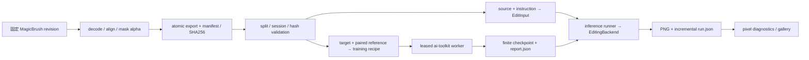

# 工程架构重构

2026-10-23可学习性阶段沿用现有边界：datasets建立只含选定Train资产的实验视图，
training复用固定trainer与观测hook，backends只测特征/梯度，evaluation隔离监督
teacher诊断与source-only生成。设计先行，见role_learnability_design.md；不重构目录。
`datasets/research_view.py`核对父cohort/实际图像SHA并仅导出Train目标/参考与共同caption；
`training/learnability_study.py`锁定6例/四方法/双seed预算，复用原launcher/worker。
`feature_observer.py`在固定上游公开hook记录原loss、角色/层梯度及成对快照，不改loss；
`feature_adapter.py`只在显式view元数据下启用，旧配置路径与目标保持兼容。
`inference/learnability_smoke.py`复用已验证的真实4B前反向/zero/位置/重载探针。

`inference/learnability.py`负责共享source/prompt/noise的Train/Dev生成与固定状态回放；
`backends/layer_response.py`以可清理的作用域hook观测Diffusers图像流，不改变模型。
`evaluation/feature_teacher.py`及`feature_gradient.py`独立加载监督target，只构造受控
noisy target状态和velocity误差；生成从不接收target。后者用共同全图分母分解
T/D/P/ignore梯度，不改训练器目标。`learnability_diagnostic_smoke.py`先验证真实GPU路径。
`learnability_provenance.py`绑定实际权重、PNG、feature tokens、source/text/noise及完整
预定矩阵；`learnability_analysis.py`复用区域/位置/阴影语义代理，另算同强度contrast、
学习曲线与门槛。Train/Dev画廊显式绑定canonical manifest，拒绝封存Test。
成对快照从network.save_weights实际写入处绑定，不使用传回optimizer.pt的上游
post_save_hook。保留上界按LoRA+encoder双倍计算，完成验收逐一复核全部历史对。

2026-10-23机制诊断复用conditioning/backends/inference/evaluation边界，仅增加观测
和显式推理干预，不改目录或默认路径。权重冻结，新增训练0步；先测量再选一个
改进，见[机制诊断预注册](role_feature_diagnostics_design.md)。
`conditioning/feature_interventions.py`仅变换既有五通道token，不读取监督；
`backends/feature_probe.py`在原fusion前后观测并配对回放CFG状态，不复制模型实现。
`inference/feature_diagnostic_study.py`引用旧checkpoint并锁定0训练预算，
`feature_diagnostics.py`复用原backend/UUID租约；`evaluation/feature_encoder_diagnostics.py`
在CPU分离类别/位置项与实际输出，不把归因指标称为质量提升。
诊断phase/逐seed receipt绑定实际输出目录、report SHA和执行源码；失败用新attempt，
成功同级任务复用。StateCapture保存实际正负分支预测，回放必须精确复现后再作归因。
`evaluation/scene_semantics.py`提供GT校准/可弃权的平移模板与阴影方向代理，
`feature_diagnostic_analysis.py`绑定原PNG SHA、分列T/D/P/位置与覆盖，
`feature_diagnostic_gallery.py`只生成非盲研究叠图，目标/背景只在evaluation读取。
CPU encoder诊断另外报告变化token内响应及单位高斯CPU噪声量化，后者不是扩散轨迹。
Phase A真实GPU及冻结权重的identity居中/能量匹配残差算子四臂比较已完成，
不增加参数/token/训练；设计与对照见[修复预注册](role_feature_repair_design.md)。
`conditioning/feature_residuals.py`仅操作冻结encoder输出，不读target；四臂共享两次
预计算，缓存绑定完整输入/grid，置乱保持pooled-valid分层。`inference/feature_repair_study.py`
冻结Phase A证据与唯一配方，`feature_repair.py`复用原融合、sampler、probes和租约。
`evaluation/feature_residual_provenance.py`校验实际数组SHA、字段、参数与算子公式，
跨设备FP32重算容差rtol1e-5/atol1e-7；旧run不携带干预字段时仍走原校验。
compare评估先复核四臂完整Dev矩阵、实际run/条件数组/checkpoint/预算，再计算指标。
`evaluation/feature_repair_analysis.py`只应用预注册门槛与场景配对bootstrap，不将
数值通过直接标为研究Go；视觉和真人状态单独保持，缺少真实评分不生成区间。
双seed各48张Dev、原始缓存24图精确复现；修复T/D门槛失败，当前No-Go，不进入
扩大训练或Predictor。人工空包与非盲观察分开，Test封存，完整证据见
[诊断实际报告](role_feature_diagnostics_report.md)。252本机测试/55 CLI与真实GPU smoke通过。

独立Role Feature试验沿用现有模块边界，见 [设计](role_feature_design.md)。
conditioning定义非RGB特征契约/编码，datasets只加载占据和角色，backends实现
FLUX的受控残差；training复用固定trainer的额外参数hook及现有worker/租约；
inference/evaluation复用run记录/分区统计并增加成对checkpoint验证。不开新框架，
不改变默认No-mask/Mask，不训练Predictor或迁移Qwen。
2026-10-23已完成232项CPU回归、43项CLI、真实4B前反向/置换/零条件/重载、
batch4容量及四方法×双seed×20updates训练；固定Dev的质量门槛与研究结论见
[特征验收报告](role_feature_report.md)。GPU接口消费成功不等于编辑质量改善。
96张Dev重载预测与哈希评估已完成，两seed研究门槛均失败；当前注入/预算No-Go
扩大训练，真人评分pending。封存Test继续只做完整性校验。
执行代码冻结在独立role-feature-run-02 worktree的b256692，114个source/config
文件与Git对象及实际训练记录相符；文档收尾不改变执行源码。
seed修复远端CPU CI通过215项、明确跳过16项（没有Torch），本机232项全部执行。
首轮GPU暴露固定上游TrainConfig无seed属性；worker从已校验原YAML读取一次seed，
set_seed与encoder适配器显式共用该值，不扩展上游配置类；保留0-batch原失败报告。
同seed四方法的初始化SHA、实际样本/噪声/timestep轨迹均相同，211/223初始化不同。
CPU分析独立冻结ad9d5c9，仅修复身份门槛字段；GPU训练/推理仍绑定b256692，
没有重训或改写预测。失败分析目录保留，成功结果另存analysis_02。

当前实现：`conditioning/features.py`定义不可变old/new/D/P/valid单位图及schema，
`feature_encoder.py`懒加载FP32小编码器；`datasets/features.py`只读取NPZ占据和
role/valid，Constant不暴露valid边界。`backends/feature_fusion.py`按实际(T,H,W,L)
ID注入噪声token，source/文本不变；`feature_checkpoint.py`绑定LoRA实际SHA、base
revision、mode和配置。`flux2_features.py`独立显式上界入口只编码source RGB。

`training/feature_config.py`锁定未增强几何/单参考/原flowmatch目标，
`feature_adapter.py`使用固定trainer原有extra-params hook，不修改external或loss；
worker成功保存FP32特征权重，异常仍保留原traceback/遥测并撤销所有hook。
`feature_study.py`固定四方法/独立seed/预算，先smoke、真实重载探针、实测batch容量，
然后有界训练/Dev推理。只支持fresh start；禁止单独恢复LoRA而漏掉编码器状态。

`inference/feature_runner.py`保存原run格式加role_features字段；
`evaluation/feature_provenance.py`重算actual encoder/LoRA/field SHA与封存Dev，
缺失metadata不得降级No-mask。`feature_smoke.py`真实检查零初始化Base、禁用Mask、
训练后零条件、角色/位置置换、空间ID、source-only VAE、反向有限梯度和PNG重载。
CPU测试不等于GPU验收，真实结果单独记入新报告。

`evaluation/feature_fairness.py`核验四组实际update样本/噪声/timestep轨迹、相同初始
encoder SHA、参数/token/预算和实际paired weights；`feature_analysis.py`复用原分区
指标与场景bootstrap，分列身份、旧位残留/新位误差代理。自动像素门槛只给必要条件，
不生成真人结果，也不能单凭这些代理宣布语义成功。
身份门槛读取s=0子集的target_mae；identity_target_mae是数据source-target差异，
不能衡量预测是否破坏身份。回归测试接入真实region_metrics/aggregate协议。

新研究沿用现有目录职责，见 [失败分析设计](role_failure_analysis_design.md)。
几何编码/占据读取、后端显式上界、研究编排和诊断分别留在 conditioning/datasets、
backends、training/inference、evaluation；不引入新目录层或修改第三方。

`conditioning/geometry.py` 校验三个同尺寸二值old/new/dependency图并编译灰度；
`datasets/geometry.py` 只打开NPZ占据字段，实际SHA绑定原evidence，禁止读取RGB监督。
ControlBundle增加独立的oracle_geometry类型，仍拒绝普通推理。P/ignore是零参考值，
不是零VAE latent。`datasets/holdout.py` 保存跨历史分组/SHA隔离及封存Test契约；
role_study复用现有训练编排，只新增Dev-only最小协议。`inference/role_diagnostics.py`
明确区分原协议重载与分布外干预，`evaluation/role_failures.py` 分离位置/颜色代理量。
新增真人失败类别向后兼容原CSV字段和旧评分；无原始真人结果时不填充任何数值。

本轮工程/真实GPU验收与研究决策见 [失败分析实际报告](role_failure_analysis_report.md)：
固定旧adapter干预120次、同预算双seed灰度pilot训练/48例Dev评估完成。当前灰度
编码未通过T改善门槛，停在小试验；当时独立角色特征层尚未实现，真实评分pending。
新Test仍封存，不能把完整性校验写成模型测试结果。

PR #3 归档为 **Causal Role Data and Oracle Feasibility Study**，合并审计见
[causal_role_feasibility_audit.md](causal_role_feasibility_audit.md)。后续 Role Conditioning
Failure Analysis 使用独立分支、全新 Dev 与封存 Test，不复用旧 Test 做模型选择。

2026-10-22收尾：202项测试及Ruff/CLI/wheel通过；20组128→512反事实场景、
四方法双seed60步训练和192张固定重载评估已完成，数据/条件/adapter/源码来源通过。
当前彩色Oracle Role编码未通过研究门槛，结论No-Go；真实三人评分仍pending。
最新验收与限制见 [实际报告](role_validation_report.md)。下文保留此前Stage 0/1
设计与实验过程，其中历史“当前”状态以其阶段日期理解。

`training/spatial.py` 区分binary与hard one-hot batch，固定版本设备补丁只增加验证，
不改上游forward/loss。`role_study.py`生成独立缓存数据副本、同预算四方法双seed配置，
按smoke→重载消费验证→batch容量→训练→固定评估执行；`infra/experiment.py`记录
argv、源码摘要、版本、时间和原始失败。`evaluation/role_metrics.py`分别量化T/D编辑
误差与P漂移，按scene等权和场景bootstrap；两seed逐项报告，不把场景区间当训练方差。

研究编排校验完整phase/method/seed矩阵，preparing计划不能启动正式比较；重载前
再核对实际train.yaml与完成报告摘要，拒绝训练后配置漂移。该门禁不改变模型计算。

公平性/角色评估将run的LoRA SHA与对应训练报告checkpoint绑定，拒绝错adapter；
角色指标读取前检查实际prediction RGB/尺寸，禁止通过隐式resize掩盖产物变化。
T/D除prediction→target误差外，另报identity source→target误差；它是诊断参考，
不作为一个训练过的No-mask模型，也不计入人工成功率。

scene sweep v2将采样范围读取自独立variations YAML，展开配置保留完整范围快照；
固定split顺序消除字典插入顺序影响。默认20个物理组与已运行v1完全一致，原v1
数据/源码指纹保留；新配置能力不改变冻结GPU实验的数据。

`evaluation/fairness.py` 对已完成训练的实际report/config/checkpoint/条件索引及
各split manifest核验等预算；复核原图与预测后重算metrics，再按显式任务注释汇总。
任务描述与人工结果分开；失败分类依赖真实评分，空表保持pending。

2026-10-22 开发范围见 [角色研究验证计划](role_validation_design.md)。沿用现有模块
职责，新增多评审统计、程序化 scene 配置和显式 Oracle 训练/评估，保持原 loss。
Dynamic Binary 依赖真值，也属于显式上界；普通推理不能使用它。计划与实际状态分开。

`evaluation/review_import.py` 管理公开评审页、单reviewer不可覆盖原始CSV导入与多版本
选择；`review_stats.py` 负责配对评分和scene/reviewer交叉重采样。原score仍兼容，
新增保存原始字节副本。三人不完整时报告pending/null区间；实际真人评分尚未收到。

`datasets/scene_sweep.py` 将固定抽样seed展开为显式物理配置；可选scene级位置、光源
和背景覆盖保留旧默认/旧group SHA。配对验证、条件导出与snapshot均覆盖可选test，
所有split两两查漏。`role_controls.py`只为验证过的合成数据导出Oracle/Dynamic
Binary索引，消费端分离target并复核实际角色编码，普通推理权限继续收紧。

## 当前开发：评估补强与最小反事实数据

Stage 1 PR #2 已正常合并 main `a03f168`；本地130项测试及 PR CI 通过，78个新增
历史blob资产审计通过（最大24,207 bytes）。新分支 `feat/role-data-and-evaluation`
保持现有目录结构；设计见 [stage2_design.md](stage2_design.md)。新增职责仍放
conditioning/datasets/backends/evaluation 内，不提前训练 Predictor 或迁移 Qwen。
原 Stage 0/1 输出均保留。下文各阶段记录按其标注时间理解。

当前已完成Constant双参考与显式No-mask cast、六组各30例重载、180项离线人工
评审工具（真实评分pending）、12对Blender图像/角色数据及Oracle GPU接口消费。
184项本机测试/79.97s、Ruff、pip/CLI及仓库外wheel检查通过；最新可执行代码的
[GitHub CPU CI](https://github.com/Vincent-Wenhan/image-editing/actions/runs/39600199742)
通过。实际预算、时间/显存、失败、数据可信域与未完成项见
[Stage 1补充报告](stage1_review_report.md)、[Stage 2实际报告](stage2_report.md)。
接口和数据通过不构成方法收益；没有提前训练Role Predictor或Qwen。

## Stage 1 开发入口

架构分支已通过 [PR #1](https://github.com/Vincent-Wenhan/image-editing/pull/1)
正常合并到 main `020c370`，push/PR GitHub CPU checks 均通过（95 passed、2 skipped；
本机完整环境 97 passed）。分阶段提交和 Stage 0 实验均保留。
`feat/static-spatial-control` 从该 main 创建；目录职责不变，新设计和实际状态见
[stage1_design.md](stage1_design.md)。下文保留重构过程记录。

Stage 1 已实现 `conditioning/static.py` 的纯变换，`datasets/control_export.py`、
`controls.py`、`snapshot.py` 的不可覆盖导出/副本与来源验证；`training/spatial.py`
在配置/worker 和实际 batch 三个边界检查双图。FLUX adapter 的双参考预处理匹配上游
cast 顺序，No-mask 不进入该处理器。runner 只读 source/声明的 mask，评估复核条件
索引和逐例来源。新增 `prepare-controls`；原九命令保留，`infer/train-config` 默认
`--control none`。2-step 双参考训练与真实编码/消融已经完成，证据与 BF16 数值差异
见 [stage1_report.md](stage1_report.md)；三组150-step、固定12例重载/配对评估均完成。
当前完整环境130项测试、Ruff、依赖/CLI检查通过；原数据和三组副本哈希复核通过，
原Stage 0资产与报告保留，所有GPU已释放。工程通过不等于静态空间方法优于No-mask。

`evaluation/budget.py` 独立核对原 No-mask 报告/config/checkpoint 的实际 SHA256，比较
完整 train/network/model/sample、数据处理参数和两个 split manifest；只允许路径与
声明的参考数量差异。其依赖限于 core/datasets，不反向调用训练器。

二值方形膨胀采用积分图窗口求和，与 PIL 的独立回归结果一致；条件导出索引不变。
这样每次验证已有 Dilated 控制图时无需重复大核排序，避免租约内的 CPU 等待。

Mask 画廊按逐例记录尺寸重建并展示实际控制输入，另列原始标注；No-mask 保留原布局。
新视图输出到独立 `gallery_controls/`，初次实验的画廊和预测不覆盖。

## 合并前检查（2026-10-21）

`origin/main=5c505e5` 是 `eaa30dc` 的祖先，分支没有分叉冲突；工作区干净，
`git diff --check` 通过。重新执行 Ruff check/format、97 项 Pytest（38.36s）、
9 个 CLI 子命令、包入口、训练/验收入口、shell 语法、`pip check` 和仓库卫生检查，
全部通过。新增提交历史的 128 个 blob 也逐一检查：没有禁止上传的资产，最大
21,223 bytes。原始 Stage 0 输出继续保留在本 worktree，不移动到 Git 或覆盖旧结果。

这些是本地合并门禁结果，不能代替 GitHub PR checks 或宣称 PR 已合并。
服务器 GitHub API 认证已就绪；创建 PR 后复核远端 head 与 checks，
通过正常 merge 保留分阶段提交，不 force push。之后从最新 main 创建
`feat/static-spatial-control`，其设计与实验状态另行记录。

## 架构收尾与稳定性验收（2026-10-21）

状态：工程修改已实现，97 项回归和 Ruff/CLI 通过。完整验收的 20-step debug、
150-step、固定 12 例重载/配对评估和画廊均已完成；详见 [Stage 0 报告](stage0_report.md)。

保持现有目录职责、网络结构和 flow loss。本轮按以下顺序完成稳定性修改及 CPU 回归，
再在正常 GPU 租约下补齐 200 train /30 dev 上的 20/150-step 验收：

1. 固定 ai-toolkit revision 的设备适配只能安装一次，重复配置只更新文本权重路径；
   测试设备迁移、原调用透传、实际 CPU loss/梯度/参数更新一致性。
2. worker 从初始化开始记录失败，finally 中尝试 cleanup、统计与缓存释放；
   次级异常单列，不替换原始训练异常/traceback。正常取消也走清理路径。
3. 评估复核 manifest 与 source/target/mask 实际 SHA256，检查样本身份、种子、
   提示、尺寸和实验配置；新运行增加可选配置摘要，旧记录仍可读取。
4. 明确输入 RGB、同尺寸 mask/有效域、硬标签与 H×W×3 概率角色场的有限值、
   范围和通道约束；只实现验证契约，不实现新的条件或预测方法。
5. 移除固定显存阈值。扩大 batch 依据 debug 实测、当前租约卡可用容量、
   保守增长上限与预留空间；未知证据不扩大，OOM 只能以新实验名和新报告降级重试。

完整验收复用已验证的 12 例 Base 记录，复制到新输出目录后先复核配置和数据；
避免无故重跑 Base。训练数据使用独立文件副本以隔离缓存，模型仍复用现有权重。
记录每次尝试的配置、耗时、显存、checkpoint、失败和固定 12 例重载评估。
完成前不将这些计划写成已通过，不开发 Static Mask、Role Predictor 或 Qwen。

## 范围与基线

本次只重构 Stage 0 工程结构，保持 FLUX.2 Klein Base 4B 的采样、训练目标、
MagicBrush 预处理、CLI 参数和实验记录格式。Static/Dilated/Soft Mask、Role
Predictor、Blender/Kubric 与 Qwen 均为未来扩展，不在本次实现。

重构从 `5c505e5` 开始，在独立 `refactor/modular-architecture` worktree 中进行。
原工作区已有的 roadmap 移至 `docs/` 的改动内容完全一致，沿用该位置。
原工作区、命名 Conda 环境、第三方源码和所有资产保留；隔离测试环境只复用已安装依赖。

开始前已阅读 AGENTS、README、全部研究方案/报告/走读、现有代码、配置和测试。
原有 19 项 CPU 测试通过。实时检查没有运行中的项目任务，8 张 A6000 均空闲。
本地资产已完整下载，200 train /30 dev 已准备；旧 Stage 0 的 12 例 Base 推理完成，
debug 训练在第一步因 CPU/CUDA 条件张量混用失败，尚无完成的 LoRA 验收。
这些是重构前的状态，不是重构后的验证结果。

## 实施顺序与验收

1. 先记录设计、兼容边界和验收方案（本提交）。
2. 按职责拆分 core / datasets / conditioning / backends / training / inference /
   evaluation / infra；删除旧包，迁移 CLI、安装入口、脚本和原有测试。
3. 增加协议、配置、安装和旧产物兼容测试；运行 Ruff、Pytest、CLI smoke。
4. 复用本地资产，在 GPU 租约下做最小真实推理；训练验证单列真实结果及已知阻断。
5. 同步 README、Stage 0 报告、实验日志、旧新映射和最终检查结果，分阶段提交推送。

每一步提交前执行与改动相称的检查。新输出使用独立目录，不覆盖旧实验。

## 模块与依赖设计

`src` 是真正的 Python package，所有自有代码使用 `src.xxx` 绝对导入。
setuptools 从仓库根发现 `src` / `src.*`，console entry point 保持 `image-edit`；
模块入口变为 `python -m src`。不提供同名顶层 `datasets` 包，不修改 `sys.path`。

| 模块 | 职责 | 允许依赖 |
|---|---|---|
| `src/core` | 输入/监督契约、IO、配置、路径、种子、实验元数据 | 标准库、Pillow、NumPy、YAML |
| `src/conditioning` | 控制图容器与现有 Mask 语义 | core、Pillow |
| `src/datasets` | MagicBrush 读取/对齐/导出、manifest、哈希与 split 验证 | core、conditioning、infra 下载 |
| `src/backends` | 公共编辑协议、FLUX.2 Diffusers 适配器 | core、conditioning、infra GPU |
| `src/inference` | 样本选择、后端调用、增量 run.json 和输出检查 | core、datasets、backends |
| `src/training` | 训练配置、固定 ai-toolkit 适配、checkpoint 验证 | core、datasets、infra |
| `src/evaluation` | 像素诊断、历史产物评估、画廊 | core、datasets、NumPy、Pillow |
| `src/infra` | 固定资产下载、断点续传、GPU 租约、环境及验收编排 | core；编排通过 CLI 调用业务 |
| `scripts` | 保留现有命令的轻量入口、环境 bootstrap、仓库检查 | 已安装的 src 包 |

底层数据对象不引用后端；推理流程不接收训练监督。重型 torch/diffusers/upstream
导入只发生在实际 GPU 执行时，帮助命令与 CPU 数据检查不初始化 CUDA。

## 数据与执行边界

稳定性收尾已实现以下契约，相关 CPU 回归通过：source/target 为非空 PIL RGB；
mask 为同尺寸 H×W 单通道，NumPy 使用有限 [0,1] 值，PIL `L` 使用 [0,255]
并按 255 归一化（`1`/`F` 也可）。`strength` 是有限 [0,1] 实数，拒绝 bool。
`EditSupervision` 的有效域必须二值且与 target 同尺寸；硬角色标签是 H×W 整数
0=T、1=D、2=P、255=ignore，ignore 不能被标为有效；软角色标签是 H×W×3 浮点
T/D/P 概率，每像素有限、在 [0,1] 且和为 1（容差 1e-5）。软场在无效像素也须
归一化，有效域单独决定监督范围。没有执行角色预测或空间控制。

`ControlBundle` 的 Mask 类型使用唯一 `mask` 图，角色类型使用唯一 `roles` 图；
Static/Dilated 必须二值，Soft 允许连续值，角色使用上述硬/软表示。构建时检查数值，
交给后端时再检查 source 几何。oracle 仍只用于未来显式上界，普通推理拒绝它。

评估现在先核实 manifest SHA256 和全部 manifest 行的 source/target/mask 实际
SHA256/模式/尺寸，再核对选择顺序、prompt、sample seed 和配置尺寸。新 `run.json`
增加可选 `config_sha256`；旧记录仍可读取，但不能仅凭旧记录独立证明 steps/CFG
从未被手工修改。`evaluate --reference-run BASE` 额外要求 Base/LoRA 的模型版本、
manifest、采样预算和固定样本完全一致。路径可迁移，数据内容不可漂移；指标公式不变。

- `EditInput` 只有 source、instruction、可选 mask/strength；不含 target、role label。
- `EditSupervision` 保存 target、可选角色标签和有效区域，单独显式加载。
- `ControlBundle` 描述 none / static / dilated / soft / oracle / predicted 控制图及元数据；
  容器不实现控制算法。Oracle 条件必须显式标记，普通推理拒绝它。
- `EditingBackend` 只统一编辑调用与输出；模型内部 Transformer 保持独立。
- 当前 FLUX 后端只支持无空间条件的 Stage 0；收到尚未实现的控制时明确报错，不能静默忽略。
- manifest 的推理读取路径只加载 source 和 instruction；训练与评估才读取 target。

配置保留 `configs/assets.lock.json` 的固定资产格式和现有完整 ai-toolkit YAML。
数据选择、实验/验收预算与模型资产分开；Python 和 shell 从配置读取默认值，
CLI 显式覆盖仍有效。生成的训练 YAML 仍可直接交给固定 ai-toolkit。
相对用户参数保持相对调用目录，仓库自带配置和第三方源码用明确的项目根定位。

ai-toolkit 在其根目录下以独立 Python worker 启动，使用正常的 `-m` 导入规则；
不改变父进程 cwd/导入路径，不修改第三方文件。GPU 租约、离线加载、commit
校验、checkpoint 有限性和现有 report 字段继续保留。

## 当前目录

```text
src/                          # package，不是传统 src-layout 的搜索根
  __init__.py, __main__.py, cli.py
  core/                       # types, spatial, config, paths, images, io, metadata, random, logging
  datasets/                   # images, export, magicbrush, manifest, validation
  conditioning/               # controls（数据契约）, masks（原有 alpha/灰度语义）
  backends/                   # base（Protocol）, flux2（实际 Diffusers 调用）
  training/                   # config, launcher, worker, flux2_compat, lifecycle, memory,
                              # checkpoints, __main__
  inference/                  # runner
  evaluation/                 # metrics, provenance, evaluate, gallery
  infra/                      # assets, transport, gpu, environment, process,
                              # repositories, repository, acceptance
configs/
  assets.lock.json            # 模型、数据、第三方 commit；格式不变
  flux2_edit_lora.yaml         # 完整旧配方；字段和算法不变
  datasets/magicbrush.yaml    # 输出根和子集数量
  experiments/stage0.yaml     # 验收预算、选择数量、诊断阈值
  conda-linux-64.lock         # 现有环境冻结
scripts/                     # train/run_stage0/check_repo 兼容入口和 bootstrap shell
tests/                       # CPU 契约、配对、传输、配置、CLI 与记录回归
docs/, notes/                # 设计、研究边界、实际实验记录
data/, models/, outputs/, external/  # 本地资产，全部忽略
```

### 核心数据流



推理流程只调用 `load_edit_input`，不加载 target/mask/oracle 标签。训练器只消费原来的
`target` + `control_path=reference` 配对，训练目标仍由固定版本的 ai-toolkit 实现。
target/mask 只在独立监督加载或评估中打开。`ControlKind.ORACLE_ROLE` 数据接口留给
将来的显式上界实验；当前普通推理和 FLUX 后端拒绝使用。类型边界不能验证未来研究者
手工标错来源的控制图，新增方法仍需按场景 split 与独立监督通路审查。

训练 worker 继承租约，在外部仓库 cwd 下运行 `python -m src.training.worker`。
安装的 `src` 包与上游 `toolkit` 通过正常导入规则共存，不依赖 `PYTHONPATH`。
上游代码只读，checkpoint 和运行报告仍写入配置指定的位置。

### 未来扩展位置

- Static/Dilated/Soft Mask：在 `conditioning` 实现处理，明确图名、顺序、归一化和几何；
  在 FLUX adapter/训练配方中接入，统一消融预算，不能只在最终 RGB 上混合。
- Dynamic Role：在 `datasets` 增加合成场景读取、分组 split 和有效区域；
  在 `conditioning` 加入强度条件预测，`EditSupervision` 单独承载角色真值。
  实际预测返回 `PREDICTED_ROLE`，oracle 上界使用单独、显式的实验流程。
- Qwen：在 `backends` 增加独立 adapter，在 `training` 增加对应训练集成；
  复用外部编辑协议和记录，不复用 FLUX Transformer/latent packing。

这些都是下一阶段位置说明，本次没有实现新控制或训练方法。

## 开发、安装和运行

首先按 README 用新的命名 Conda 环境恢复锁定依赖，再从仓库根执行：

```bash
pip install -e '.[dev]'
image-edit --help
python -m src --help
python -m ruff check .
python -m ruff format --check .
python -m pytest -q
python scripts/check_repo.py --all
```

setuptools 显式只发现 `src` 和 `src.*`；wheel 附带运行默认配置，避免安装后找不到 YAML。
CPU CI 可用 `pip install --no-deps --no-build-isolation -e .`，只安装 NumPy/Pillow/YAML
和测试工具；torch/safetensors 相关测试按依赖可用性执行，不能算作真实 GPU 验证。
无需设置 `PYTHONPATH`。`src.datasets` 不会遮蔽 Hugging Face 的顶层 `datasets`。

所有原有 CLI 子命令与默认参数保留。推理 `run.json`、逐图字段、metrics CSV/JSON、
manifest、下载 marker、训练 report 和 Stage 0 status 的键保持兼容。
检查旧记录时复制小型记录/预测到新的 `outputs/` 目录再评估，保留旧实验。
新旧 Python 包路径有意不兼容：旧 `image_editing.*` 导入与 `python -m image_editing`
改用本文件迁移表；命名环境需要在切换分支后重新 `pip install -e .`。

### 旧文件到新模块

| 原位置 | 新位置 / 职责 |
|---|---|
| `common.py` | `core/io.py`, `metadata.py`, `random.py`；命令查询 → `infra/process.py` |
| `data.py` | `datasets/images.py`, `export.py`, `magicbrush.py`；Mask → `conditioning/masks.py` |
| `validation.py` | `datasets/validation.py`；安全路径 → `core/paths.py` |
| `inference.py` | `inference/runner.py` + `backends/flux2.py`；尺寸 → `core/images.py` |
| `training.py` | `training/config.py` |
| `scripts/train.py` | `training/launcher.py`, `worker.py`, `flux2_compat.py`, `checkpoints.py`；原脚本保留为入口 |
| `evaluation.py` | `evaluation/metrics.py`, `evaluate.py` |
| `gallery.py` | `evaluation/gallery.py` |
| `assets.py`, `transport.py` | `infra/assets.py`, `transport.py` |
| `gpu.py`, `environment.py` | `infra/gpu.py`, `environment.py` |
| `scripts/run_stage0.py` | `infra/acceptance.py`；原脚本保留为入口 |
| `scripts/check_repo.py` | `infra/repository.py`；原脚本保留为入口 |
| setup shell 中的仓库逻辑 | `infra/repositories.py` |
| `__init__.py`, `cli.py`, `__main__.py` | `src/__init__.py`, `src/cli.py`, `src/__main__.py` |

表中不带路径前缀的旧 Python 文件均位于已删除的 `src/image_editing/`；没有保留双份实现。

## 上一轮架构迁移的兼容性检查

- 完整锁定依赖环境：50 项测试通过；独立无 torch 的 CPU 环境：49 项通过、1 项跳过
  （checkpoint 张量测试，完整环境已执行）。Ruff check / format、`pip check`、shell 语法和仓库卫生检查通过。
- 已完成新结构下一例真实 Base 推理（512²、50 steps、CFG 4）：23.36 秒，
  峰值 reserved 15.95 GiB；sample `dev_140513_t1` 与旧记录 seed 相同，
  PNG SHA256 完全相同：`890bcd4efb235202410f73ed1f6f1ef0eca52d00bed2c0b35b91755c40c4e614`。
- 证据留在 worktree 的 `outputs/refactor_validation/base/`，不进入 Git。

| 功能 | 重构前 | 重构后证据与边界 |
|---|---|---|
| 安装与导入 | `src/image_editing` 搜索根 | editable + wheel 均安装通过，仓库外导入/配置/CLI 通过；无 `sys.path` 修改 |
| CLI | 9 个子命令及原脚本参数 | 对重构前直接采集的默认值快照逐项相等，全部帮助和薄脚本入口通过 |
| 模型/数据下载 | 固定 revision、分块/续传/哈希 | lock 与传输行为保留，本地 HTTP 字节续传/坏哈希/错误 revision 拒绝测试通过；未重下真实资产 |
| MagicBrush | first-turn、反向 alpha、几何统一 | 保留；真实 200/30 全集哈希/配对/尺寸/split 检查通过，session/source overlap 均为 0 |
| 输入与监督隔离 | runner 自行选 source | 独立契约和加载函数；删除 target/mask 后仍能加载输入，oracle 普通推理被拒绝 |
| Base 推理 | 本地 BF16 常驻，50 steps /CFG 4 | 1 例真实重跑，seed/PNG SHA256 与旧结果完全一致 |
| LoRA 配方 | flowmatch/sigmoid、AdamW、原 YAML | 配方参数和 CLI 生成测试通过；两步真实训练保存 160 个有限张量，并完成一例同配置重载 |
| GPU 管理 | 空闲检测、UUID 文件锁、二次检查 | 原实现保留；竞争测试通过，所有真实 GPU 验证经租约启动并正常释放 |
| 评估与画廊 | MAE/漂移/变化面积、HTML/contact sheet | 复制旧 12 例后重新评估，完整 metrics.json 与旧报告相等；新画廊通过 |
| 记录格式 | manifest/run/report/status/metrics | 字段结构及错误状态回归通过，旧文件保留；新结果写入独立目录 |
| 第三方与环境 | 固定源码和命名 Conda | 3 个外部 Git checkout 均无改动；原 Conda editable 安装仍指向原工作区 |

上一轮未重新执行原定 200 样本上的 20/150-step 完整训练、12 例 LoRA 评估，
也没有 Static Mask / Role / Qwen 验证。两个 GPU 推理样本和两步训练只验收工程行为。

开发交付位于 `/home/jiangwenhan/project/image-editing-architecture`；原工作区保持用户的
roadmap 移动状态。该 worktree 的 `.venv` 单独 editable 安装并复用命名 Conda 依赖：

```bash
cd /home/jiangwenhan/project/image-editing-architecture
.venv/bin/image-edit --help
# 编译扩展相关训练继续继承 Conda 编译器环境
conda run --no-capture-output -n image-edit "$PWD/.venv/bin/python" -m src.training --help
```

一次性的 CPU 验证环境、wheel 和构建目录已在结束前清理，验证日志/配置/产物保留在
`outputs/refactor_validation/`。本轮已补齐完整 Stage 0 工程验收；后续按 conditioning →
FLUX adapter/训练配置 → 公平消融的顺序开发 Static Mask。

### 固定训练器的设备兼容修复

本轮加固后，补丁绑定 `SUPPORTED_TRAINER_REVISION`，launcher/worker 仍各自核实 Git
版本；重复安装保留同一个 wrapper，只允许更新本地文本编码器路径。新增 CPU 测试
检查多次设备变化、dtype 保留，以及同输入下 loss、梯度和两次 AdamW 更新逐值一致。
没有更改原方法计算或网络结构。

worker 从初始化开始创建报告，训练异常与 traceback 原样保留；finally 在清理前
分别采集显存数据，即使同步失败也继续读取其余统计。cleanup/empty_cache/报告写入
失败单独记录或输出日志，不能替换原训练异常。清理失败也不能报告成功。
SIGTERM 进入同一清理路径，launcher 等待 worker 退出后才结束租约任务。

自动 batch 规划在当前 UUID 租约内读取实际卡容量及占用，核对 debug 报告和其配置
SHA256。只有训练参数/数据一致、参考至少 20 steps、统计完整时才允许增长，最多
2 倍，并按全部 reserved 峰值线性放大作保守估计；预留 max(卡容量×20%, 4 GiB)。
不再使用固定 22 GiB 阈值。实际 batch 和依据写入新的 `.effective.yaml` / `.memory.json`
并进入训练报告。预检不通过直接拒绝；放大后仍 OOM 时，Stage 0 最多用新实验名
`smoke_retry` 降到已验证 batch 重试一次，保留第一份失败报告及 checkpoint。
估计不能保证永不 OOM，因此保留这条有界恢复路径；其他异常直接失败。

验收脚本新增 `--base-run`，仅复用与锁定 Base、默认采样预算和当前数据内容一致的
无 LoRA 记录。12 例只复制到新输出；重载评估使用 `--reference-run` 检查预算。
完整验收代码版本为 `26bc4c2`，结果位于 worktree 的
`outputs/stage0_stability_20261021/`。20-step batch 2 为 199.58s /15.04 GiB reserved；
150-step batch 4 为 787.24s /15.10 GiB reserved；12 例重载生成合计 317.94s，
全阶段 390.92s /16.26 GiB reserved。checkpoint 元数据步数分别为 20、150，
各 160 个张量均有限，哈希复核通过；本轮没有实际 OOM 或清理错误。
原数据与副本训练后再次检查通过，GPU 已释放。完整验收总计 1460.10s；
没有开发或验证 Static Mask、Role Predictor 或 Qwen。OOM 恢复只经 CPU 注入测试，
本轮未触发；自适应 batch 仅用于工程验收，研究对照须固定训练样本/计算预算。

最初问题与上一轮最小验证（历史记录）：旧运行的错误发生在固定 ai-toolkit
`flux2_model.py:415`：主 latent 在 CUDA，
reference 编码结果在 CPU。其缓存流程主动卸载 VAE 到 CPU，随后 FLUX 在
`get_noise_prediction` 仍调用 VAE 编码原始 reference，造成跨设备拼接。
本次在自有 `training/flux2_compat.py` 对固定 Klein 类的公开调用边界做小型适配：
存在 reference 时，将 VAE 放回当前 latent 的 device，再委托原方法。
仅调整设备放置，不改 tensor 数值转换、flow loss、采样或任何网络结构；保留原 dtype。
适配只在校验固定 commit 后安装，不写入第三方文件。6 项 CPU stub 测试检查条件与调用
透传；已在复制出的 8 train /2 dev 小数据目录运行两步 batch 2 训练，保存 160 个有限
LoRA 张量，训练含加载/缓存共 72.25s，峰值 reserved 15.04 GiB。
同样本 50-step LoRA 重载通过：27.08s，峰值 reserved 16.26 GiB。
最初 20-step 的失败记录保留，150-step 当时未开始；本轮已补齐 20/150-step 与 12 例重载。

### 匹配参考结构与预处理

`constant_mask` 复用原条件导出/哈希/训练batch边界，输出固定黑图而非零latent。
`core/references.py` 定义预处理名称；runner记录显式选择，evaluation复核配置。
No-mask默认仍为单PIL/Diffusers顺序，显式training选项才进入受限预处理；双参考
仍匹配上游cast。未修改训练loss或网络结构。

### 人工评估边界

`evaluation/review.py` 验证完整运行/配对预算后导出匿名任务与图片，私有方法映射与
公开表单分离；`review_page.py` 只生成离线评分界面。导入复核原运行和图片、映射及
副本哈希，拒绝任务丢失/重复、非法评分和缺失评审者。未填写项保留pending；人工
结果不替代原有pixel metrics，也不会自动把模型或像素诊断当作真人评分。

`inference/reference_smoke.py` 为匹配结构的独立GPU协议门禁，复用同一个常驻模型，
记录legacy/training单参考与constant双参考的真实编码/token和重复采样；不改变训练。

### 最小场景数据管线

- `datasets/scene.py`：CPU生成/只读校验入口、独立renderer进程、失败/耗时报告。
- `scene_config.py`：显式物理参数与按物理场景分组的split约束。
- `blender_scene.py` / `blender_render.py`：可选bpy，仅实际渲染进程导入；纯漫反射、点光源、关闭间接影响；保存正常/关闭shadow-ray/对象占据/空场线性证据和EXR。
- `scene_pairs.py`：标准source/target/mask manifest与独立roles/valid监督；RGB显示变换与线性标签计算分开。
- `conditioning/role_truth.py`：占据T、隔离阴影干预D、可信P及ignore边界。
- `scene_validation.py`：实际SHA、配对/scene-group/强度、标签重算和背景显露复核；不依赖Blender或GPU。

角色标签不进入普通输入加载；MagicBrush验证与所有旧路径保持原职责。

### 显式 Oracle 数据/模型接口

`datasets/scene_manifest.py` 分别加载 target/roles/valid 的监督和仅source/labels/valid的
oracle条件；后者核对canonical manifest和实际标签/source哈希，不打开target或反事实RGB。
`conditioning/oracle.py` 不接收target，按有效域编译硬标签为T/D/P，ignore为黑RGB。
`backends/flux2_oracle.py` 要求明确upper-bound用途、encoding、哈希、几何及
`allow_oracle=True`；`Flux2Backend.edit_oracle`复用生成流程，普通edit仍拒绝Oracle。
标量strength额外输入明确拒绝；当前物理强度写在数据指令与监督元数据，未开发预测器。
共享 `reference_trace.py` 的作用域hooks供预处理/Oracle smoke验证真实编码和attention，
异常也移除hook。角色条件本轮只接推理，训练CLI仍不接受Oracle，不修改网络或loss。

`infra/blender_runtime.py` 使用固定Ubuntu包锁将可选动态库提取到忽略目录，支持
已有完整缓存的哈希验证；scene仅在CPU渲染子进程追加LD_LIBRARY_PATH并隐藏CUDA。
Blender严格核对数值版本4.5.3，保留显示字符串“4.5.3 LTS”和build hash作元数据。
不把LTS显示后缀当版本漂移，也不放宽成任意4.5版本。

真实渲染发现并集内部轮廓的采样歧义：valid需分别排除source/target每条silhouette，
不能只处理union外边缘。场景校验与oracle loader同时拒绝failed/running的生成报告；
只有生成器内部验收允许自己的running状态，不影响默认只读验证。

盲评支持同内容独立数据副本：按各run声明的conditioning.data_root复核控制来源，
再核对共用展示数据的实际SHA；映射记录验证根，导入沿用同一验证路径。这样无需
改写旧run.json路径或丢弃来源约束。预测实际RGB/尺寸也必须与记录相符。

`evaluation/gallery.py --show-roles` 复用现有画廊入口，先验证场景再从真实监督生成
T/D/P RGB和valid两列。可与实际Mask控制图/预测共同展示，原标注、valid和control
分别命名，避免视图列错配。默认不增加列，旧No-mask/Mask布局与测试保留。
