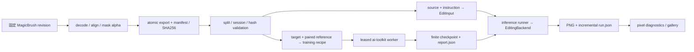

# 工程架构重构

## 架构收尾与稳定性验收（2026-10-21，计划）

保持现有目录职责、网络结构和 flow loss。本轮先完成以下稳定性修改及 CPU 回归，
再在正常 GPU 租约下执行 200 train /30 dev 上尚未完成的 20/150-step 验收：

1. 固定 ai-toolkit revision 的设备适配只能安装一次，重复配置只更新文本权重路径；
   测试设备迁移、原调用透传、实际 CPU loss/梯度/参数更新一致性。
2. worker 从初始化开始记录失败，finally 中尝试 cleanup、统计与缓存释放；
   次级异常单列，不替换原始训练异常/traceback。正常取消也走清理路径。
3. 评估复核 manifest 与 source/target/mask 实际 SHA256，检查样本身份、种子、
   提示、尺寸和实验配置；新运行增加可选配置摘要，旧记录仍可读取。
4. 明确输入 RGB、同尺寸 mask/有效域、硬标签与 H×W×3 概率角色场的有限值、
   范围和通道约束；只实现验证契约，不实现新的条件或预测方法。
5. 移除固定显存阈值。扩大 batch 依据 debug 实测、当前租约卡可用容量、
   保守增长上限与预留空间；未知证据不扩大，OOM 只能以新实验名和新报告降级重试。

完整验收复用已验证的 12 例 Base 记录，复制到新输出目录后先复核配置和数据；
避免无故重跑 Base。训练数据使用独立文件副本以隔离缓存，模型仍复用现有权重。
记录每次尝试的配置、耗时、显存、checkpoint、失败和固定 12 例重载评估。
完成前不将这些计划写成已通过，不开发 Static Mask、Role Predictor 或 Qwen。

## 范围与基线

本次只重构 Stage 0 工程结构，保持 FLUX.2 Klein Base 4B 的采样、训练目标、
MagicBrush 预处理、CLI 参数和实验记录格式。Static/Dilated/Soft Mask、Role
Predictor、Blender/Kubric 与 Qwen 均为未来扩展，不在本次实现。

重构从 `5c505e5` 开始，在独立 `refactor/modular-architecture` worktree 中进行。
原工作区已有的 roadmap 移至 `docs/` 的改动内容完全一致，沿用该位置。
原工作区、命名 Conda 环境、第三方源码和所有资产保留；隔离测试环境只复用已安装依赖。

开始前已阅读 AGENTS、README、全部研究方案/报告/走读、现有代码、配置和测试。
原有 19 项 CPU 测试通过。实时检查没有运行中的项目任务，8 张 A6000 均空闲。
本地资产已完整下载，200 train /30 dev 已准备；旧 Stage 0 的 12 例 Base 推理完成，
debug 训练在第一步因 CPU/CUDA 条件张量混用失败，尚无完成的 LoRA 验收。
这些是重构前的状态，不是重构后的验证结果。

## 实施顺序与验收

1. 先记录设计、兼容边界和验收方案（本提交）。
2. 按职责拆分 core / datasets / conditioning / backends / training / inference /
   evaluation / infra；删除旧包，迁移 CLI、安装入口、脚本和原有测试。
3. 增加协议、配置、安装和旧产物兼容测试；运行 Ruff、Pytest、CLI smoke。
4. 复用本地资产，在 GPU 租约下做最小真实推理；训练验证单列真实结果及已知阻断。
5. 同步 README、Stage 0 报告、实验日志、旧新映射和最终检查结果，分阶段提交推送。

每一步提交前执行与改动相称的检查。新输出使用独立目录，不覆盖旧实验。

## 模块与依赖设计

`src` 是真正的 Python package，所有自有代码使用 `src.xxx` 绝对导入。
setuptools 从仓库根发现 `src` / `src.*`，console entry point 保持 `image-edit`；
模块入口变为 `python -m src`。不提供同名顶层 `datasets` 包，不修改 `sys.path`。

| 模块 | 职责 | 允许依赖 |
|---|---|---|
| `src/core` | 输入/监督契约、IO、配置、路径、种子、实验元数据 | 标准库、Pillow、YAML |
| `src/conditioning` | 控制图容器与现有 Mask 语义 | core、Pillow |
| `src/datasets` | MagicBrush 读取/对齐/导出、manifest、哈希与 split 验证 | core、conditioning、infra 下载 |
| `src/backends` | 公共编辑协议、FLUX.2 Diffusers 适配器 | core、conditioning、infra GPU |
| `src/inference` | 样本选择、后端调用、增量 run.json 和输出检查 | core、datasets、backends |
| `src/training` | 训练配置、固定 ai-toolkit 适配、checkpoint 验证 | core、datasets、infra |
| `src/evaluation` | 像素诊断、历史产物评估、画廊 | core、datasets、NumPy、Pillow |
| `src/infra` | 固定资产下载、断点续传、GPU 租约、环境及验收编排 | core；编排通过 CLI 调用业务 |
| `scripts` | 保留现有命令的轻量入口、环境 bootstrap、仓库检查 | 已安装的 src 包 |

底层数据对象不引用后端；推理流程不接收训练监督。重型 torch/diffusers/upstream
导入只发生在实际 GPU 执行时，帮助命令与 CPU 数据检查不初始化 CUDA。

## 数据与执行边界

- `EditInput` 只有 source、instruction、可选 mask/strength；不含 target、role label。
- `EditSupervision` 保存 target、可选角色标签和有效区域，单独显式加载。
- `ControlBundle` 描述 none / static / dilated / soft / oracle / predicted 控制图及元数据；
  容器不实现控制算法。Oracle 条件必须显式标记，普通推理拒绝它。
- `EditingBackend` 只统一编辑调用与输出；模型内部 Transformer 保持独立。
- 当前 FLUX 后端只支持无空间条件的 Stage 0；收到尚未实现的控制时明确报错，不能静默忽略。
- manifest 的推理读取路径只加载 source 和 instruction；训练与评估才读取 target。

配置保留 `configs/assets.lock.json` 的固定资产格式和现有完整 ai-toolkit YAML。
数据选择、实验/验收预算与模型资产分开；Python 和 shell 从配置读取默认值，
CLI 显式覆盖仍有效。生成的训练 YAML 仍可直接交给固定 ai-toolkit。
相对用户参数保持相对调用目录，仓库自带配置和第三方源码用明确的项目根定位。

ai-toolkit 在其根目录下以独立 Python worker 启动，使用正常的 `-m` 导入规则；
不改变父进程 cwd/导入路径，不修改第三方文件。GPU 租约、离线加载、commit
校验、checkpoint 有限性和现有 report 字段继续保留。

## 当前目录

```text
src/                          # package，不是传统 src-layout 的搜索根
  __init__.py, __main__.py, cli.py
  core/                       # types, config, paths, images, io, metadata, random, logging
  datasets/                   # images, export, magicbrush, manifest, validation
  conditioning/               # controls（数据契约）, masks（原有 alpha/灰度语义）
  backends/                   # base（Protocol）, flux2（实际 Diffusers 调用）
  training/                   # config, launcher, worker, flux2_compat, checkpoints, __main__
  inference/                  # runner
  evaluation/                 # metrics, evaluate, gallery
  infra/                      # assets, transport, gpu, environment, process,
                              # repositories, repository, acceptance
configs/
  assets.lock.json            # 模型、数据、第三方 commit；格式不变
  flux2_edit_lora.yaml         # 完整旧配方；字段和算法不变
  datasets/magicbrush.yaml    # 输出根和子集数量
  experiments/stage0.yaml     # 验收预算、选择数量、诊断阈值
  conda-linux-64.lock         # 现有环境冻结
scripts/                     # train/run_stage0/check_repo 兼容入口和 bootstrap shell
tests/                       # CPU 契约、配对、传输、配置、CLI 与记录回归
docs/, notes/                # 设计、研究边界、实际实验记录
data/, models/, outputs/, external/  # 本地资产，全部忽略
```

### 核心数据流



推理流程只调用 `load_edit_input`，不加载 target/mask/oracle 标签。训练器只消费原来的
`target` + `control_path=reference` 配对，训练目标仍由固定版本的 ai-toolkit 实现。
target/mask 只在独立监督加载或评估中打开。`ControlKind.ORACLE_ROLE` 数据接口留给
将来的显式上界实验；当前普通推理和 FLUX 后端拒绝使用。类型边界不能验证未来研究者
手工标错来源的控制图，新增方法仍需按场景 split 与独立监督通路审查。

训练 worker 继承租约，在外部仓库 cwd 下运行 `python -m src.training.worker`。
安装的 `src` 包与上游 `toolkit` 通过正常导入规则共存，不依赖 `PYTHONPATH`。
上游代码只读，checkpoint 和运行报告仍写入配置指定的位置。

### 未来扩展位置

- Static/Dilated/Soft Mask：在 `conditioning` 实现处理，明确图名、顺序、归一化和几何；
  在 FLUX adapter/训练配方中接入，统一消融预算，不能只在最终 RGB 上混合。
- Dynamic Role：在 `datasets` 增加合成场景读取、分组 split 和有效区域；
  在 `conditioning` 加入强度条件预测，`EditSupervision` 单独承载角色真值。
  实际预测返回 `PREDICTED_ROLE`，oracle 上界使用单独、显式的实验流程。
- Qwen：在 `backends` 增加独立 adapter，在 `training` 增加对应训练集成；
  复用外部编辑协议和记录，不复用 FLUX Transformer/latent packing。

这些都是下一阶段位置说明，本次没有实现新控制或训练方法。

## 开发、安装和运行

首先按 README 用新的命名 Conda 环境恢复锁定依赖，再从仓库根执行：

```bash
pip install -e '.[dev]'
image-edit --help
python -m src --help
python -m ruff check .
python -m ruff format --check .
python -m pytest -q
python scripts/check_repo.py --all
```

setuptools 显式只发现 `src` 和 `src.*`；wheel 附带运行默认配置，避免安装后找不到 YAML。
CPU CI 可用 `pip install --no-deps --no-build-isolation -e .`，只安装 NumPy/Pillow/YAML
和测试工具；torch/safetensors 相关测试按依赖可用性执行，不能算作真实 GPU 验证。
无需设置 `PYTHONPATH`。`src.datasets` 不会遮蔽 Hugging Face 的顶层 `datasets`。

所有原有 CLI 子命令与默认参数保留。推理 `run.json`、逐图字段、metrics CSV/JSON、
manifest、下载 marker、训练 report 和 Stage 0 status 的键保持兼容。
检查旧记录时复制小型记录/预测到新的 `outputs/` 目录再评估，保留旧实验。
新旧 Python 包路径有意不兼容：旧 `image_editing.*` 导入与 `python -m image_editing`
改用本文件迁移表；命名环境需要在切换分支后重新 `pip install -e .`。

### 旧文件到新模块

| 原位置 | 新位置 / 职责 |
|---|---|
| `common.py` | `core/io.py`, `metadata.py`, `random.py`；命令查询 → `infra/process.py` |
| `data.py` | `datasets/images.py`, `export.py`, `magicbrush.py`；Mask → `conditioning/masks.py` |
| `validation.py` | `datasets/validation.py`；安全路径 → `core/paths.py` |
| `inference.py` | `inference/runner.py` + `backends/flux2.py`；尺寸 → `core/images.py` |
| `training.py` | `training/config.py` |
| `scripts/train.py` | `training/launcher.py`, `worker.py`, `flux2_compat.py`, `checkpoints.py`；原脚本保留为入口 |
| `evaluation.py` | `evaluation/metrics.py`, `evaluate.py` |
| `gallery.py` | `evaluation/gallery.py` |
| `assets.py`, `transport.py` | `infra/assets.py`, `transport.py` |
| `gpu.py`, `environment.py` | `infra/gpu.py`, `environment.py` |
| `scripts/run_stage0.py` | `infra/acceptance.py`；原脚本保留为入口 |
| `scripts/check_repo.py` | `infra/repository.py`；原脚本保留为入口 |
| setup shell 中的仓库逻辑 | `infra/repositories.py` |
| `__init__.py`, `cli.py`, `__main__.py` | `src/__init__.py`, `src/cli.py`, `src/__main__.py` |

表中不带路径前缀的旧 Python 文件均位于已删除的 `src/image_editing/`；没有保留双份实现。

## 最终兼容性检查

- 完整锁定依赖环境：50 项测试通过；独立无 torch 的 CPU 环境：49 项通过、1 项跳过
  （checkpoint 张量测试，完整环境已执行）。Ruff check / format、`pip check`、shell 语法和仓库卫生检查通过。
- 已完成新结构下一例真实 Base 推理（512²、50 steps、CFG 4）：23.36 秒，
  峰值 reserved 15.95 GiB；sample `dev_140513_t1` 与旧记录 seed 相同，
  PNG SHA256 完全相同：`890bcd4efb235202410f73ed1f6f1ef0eca52d00bed2c0b35b91755c40c4e614`。
- 证据留在 worktree 的 `outputs/refactor_validation/base/`，不进入 Git。

| 功能 | 重构前 | 重构后证据与边界 |
|---|---|---|
| 安装与导入 | `src/image_editing` 搜索根 | editable + wheel 均安装通过，仓库外导入/配置/CLI 通过；无 `sys.path` 修改 |
| CLI | 9 个子命令及原脚本参数 | 对重构前直接采集的默认值快照逐项相等，全部帮助和薄脚本入口通过 |
| 模型/数据下载 | 固定 revision、分块/续传/哈希 | lock 与传输行为保留，本地 HTTP 字节续传/坏哈希/错误 revision 拒绝测试通过；未重下真实资产 |
| MagicBrush | first-turn、反向 alpha、几何统一 | 保留；真实 200/30 全集哈希/配对/尺寸/split 检查通过，session/source overlap 均为 0 |
| 输入与监督隔离 | runner 自行选 source | 独立契约和加载函数；删除 target/mask 后仍能加载输入，oracle 普通推理被拒绝 |
| Base 推理 | 本地 BF16 常驻，50 steps /CFG 4 | 1 例真实重跑，seed/PNG SHA256 与旧结果完全一致 |
| LoRA 配方 | flowmatch/sigmoid、AdamW、原 YAML | 配方参数和 CLI 生成测试通过；两步真实训练保存 160 个有限张量，并完成一例同配置重载 |
| GPU 管理 | 空闲检测、UUID 文件锁、二次检查 | 原实现保留；竞争测试通过，所有真实 GPU 验证经租约启动并正常释放 |
| 评估与画廊 | MAE/漂移/变化面积、HTML/contact sheet | 复制旧 12 例后重新评估，完整 metrics.json 与旧报告相等；新画廊通过 |
| 记录格式 | manifest/run/report/status/metrics | 字段结构及错误状态回归通过，旧文件保留；新结果写入独立目录 |
| 第三方与环境 | 固定源码和命名 Conda | 3 个外部 Git checkout 均无改动；原 Conda editable 安装仍指向原工作区 |

本次未重新执行原定 200 样本上的 20/150-step 完整训练、12 例 LoRA 评估，
也没有 Static Mask / Role / Qwen 验证。两个 GPU 推理样本和两步训练只验收工程行为。

开发交付位于 `/home/jiangwenhan/project/image-editing-architecture`；原工作区保持用户的
roadmap 移动状态。该 worktree 的 `.venv` 单独 editable 安装并复用命名 Conda 依赖：

```bash
cd /home/jiangwenhan/project/image-editing-architecture
.venv/bin/image-edit --help
# 编译扩展相关训练继续继承 Conda 编译器环境
conda run --no-capture-output -n image-edit "$PWD/.venv/bin/python" -m src.training --help
```

一次性的 CPU 验证环境、wheel 和构建目录已在结束前清理，验证日志/配置/产物保留在
`outputs/refactor_validation/`。后续先完成完整 Stage 0 基线，再按 conditioning →
FLUX adapter/训练配置 → 公平消融的顺序开发 Static Mask。

### 固定训练器的设备兼容修复

旧运行的错误发生在固定 ai-toolkit `flux2_model.py:415`：主 latent 在 CUDA，
reference 编码结果在 CPU。其缓存流程主动卸载 VAE 到 CPU，随后 FLUX 在
`get_noise_prediction` 仍调用 VAE 编码原始 reference，造成跨设备拼接。
本次在自有 `training/flux2_compat.py` 对固定 Klein 类的公开调用边界做小型适配：
存在 reference 时，将 VAE 放回当前 latent 的 device，再委托原方法。
仅调整设备放置，不改 tensor 数值转换、flow loss、采样或任何网络结构；保留原 dtype。
适配只在校验固定 commit 后安装，不写入第三方文件。6 项 CPU stub 测试检查条件与调用
透传；已在复制出的 8 train /2 dev 小数据目录运行两步 batch 2 训练，保存 160 个有限
LoRA 张量，训练含加载/缓存共 72.25s，峰值 reserved 15.04 GiB。
同样本 50-step LoRA 重载通过：27.08s，峰值 reserved 16.26 GiB。
原 20/150-step 失败记录保留，完整预算验收未重跑。
